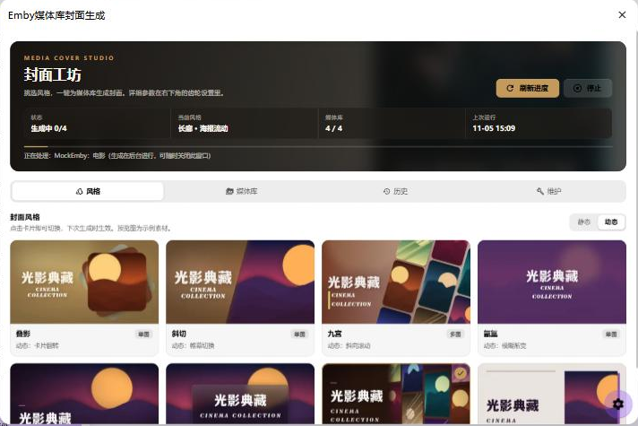
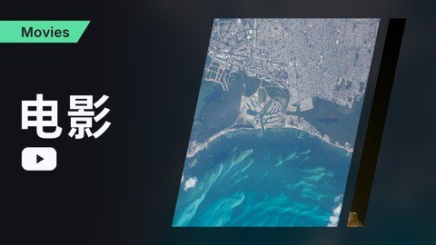
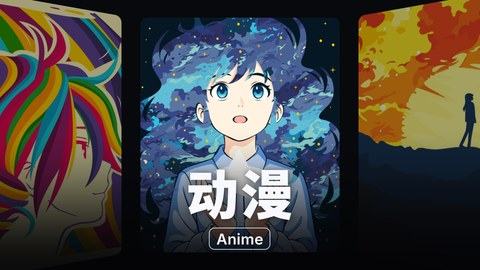
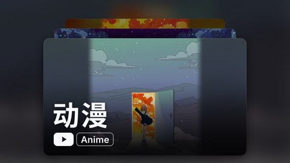

# MoviePilot-Plugins

forked from https://github.com/justzerock/MoviePilot-Plugins

MoviePilot 官方插件市场：https://github.com/jxxghp/MoviePilot-Plugins

## 媒体库封面生成

为 Emby / Jellyfin 媒体库生成静态或动态封面，同时支持 MoviePilot V3 和 V2。由 Kioo 维护和优化。

参考项目：https://github.com/HappyQuQu/jellyfin-library-poster




### 封面风格

8 款风格都有静态和动态两个版本。下图使用程序绘制的示例素材，实际效果取决于媒体库的图片。

| | | | |
| :-: | :-: | :-: | :-: |
|  |  |  |  |
| 叠影 · 单图 | 斜切 · 单图 | 九宫 · 多图 | 氤氲 · 单图 |
|  |  |  |  |
| 影院 · 单图 | 磨砂 · 单图 | 长廊 · 多图 | 刊物 · 单图 |

### 使用

1. 在插件设置的「基础」页启用插件，选择媒体服务器并保存。
2. 打开插件详情页，选好风格后点「生成全部封面」，或在「媒体库」页只更新其中一个。

生成在后台进行，可以随时关闭窗口，回来后点「刷新」查看进度。

### 标题配置

在设置的「标题」页按媒体库名称配置，点「按我的媒体库生成」可以自动填入尚未配置的媒体库。没有配置的媒体库直接使用媒体库名称。

```yaml
电影:
  - 电影        # 主标题
  - MOVIES      # 副标题，可以留空 ""
  - "#B5845C"   # 背景色，可选，需要把「背景色来源」设为「从标题配置读取」
```

### 一键排版

设置的「字体排版」页提供经典、现代、冲击、文艺、招牌、留白六套预设，点一下就会填好字体、字号、间距和背景参数，之后还可以手动微调。记得保存。

### 自定义图片

把图片放进与媒体库同名的子目录，例如 `/mnt/custom/电影/a.jpg`，然后在「目录与历史」页填写 `/mnt/custom`。插件只读取这个目录，不会改动里面的文件。图片不够时会重复使用。

### 开发

调整风格后运行下面的命令重新生成预览图（需要 pillow 和 numpy）：

```bash
python scripts/render_previews.py
```
