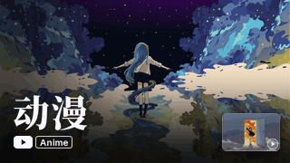
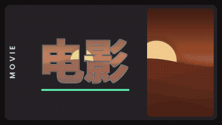
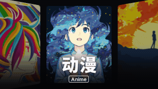

# MoviePilot-Plugins

forked from https://github.com/justzerock/MoviePilot-Plugins

MoviePilot 官方插件市场：https://github.com/jxxghp/MoviePilot-Plugins

## 媒体库封面生成

为 Emby / Jellyfin 媒体库生成静态或动态封面，同时支持 MoviePilot V3 和 V2。由 Kioo 维护和优化。

参考项目：https://github.com/HappyQuQu/jellyfin-library-poster


### 封面风格

8 款风格都有静态图和 GIF 动图两个版本，每款的背景构图和文字排版是成套设计的。下图使用程序绘制的示例素材，实际效果取决于媒体库的图片。

| | | | |
| :-: | :-: | :-: | :-: |
|  |  |  |  |
| 切片 · 海报 | 巨幕 · 背景图 | 镂字 · 背景图 | 展墙 · 海报 |
|  |  |  |  |
| 瀑布 · 海报 | 立柱 · 海报 | 悬卡 · 背景图 | 霓虹 · 海报 |

### 使用

1. 在插件设置的「基础」页启用插件，选择媒体服务器并保存。
2. 打开插件详情页，选好风格后点「生成全部封面」，或在「媒体库」页只更新其中一个。

生成在后台进行，可以随时关闭窗口，回来后点「刷新」查看进度。

### 标题配置

在设置的「标题」页按媒体库名称配置，点「按我的媒体库生成」可以自动填入尚未配置的媒体库。没有配置的媒体库直接使用媒体库名称。

```yaml
电影:
  - 电影        # 主标题
  - MOVIES      # 副标题，可以留空 ""
  - "#58DDA3"   # 点缀色，可选，需要把「点缀色」的颜色来源设为「从标题配置读取」
```

### 动图

动图只输出 GIF，Hills、小幻影视、yamby 这些客户端都当作普通图片处理。首帧就是完整封面，只显示静态图的客户端看到的也是成品。画面大部分时间静止、只在转场时运动，480×270 的动图通常只有 1 到 4 MB。生成动图需要容器内有 ffmpeg。

### 字体排版

每款风格都有设计好的字体、字号、字距和间距，所以设置的「字体排版」页默认全部留空。想换字体可以点「字体搭配」里的卡片，字号和间距仍然跟随风格；只有手动填写的项才会覆盖风格的设计。标题放不下时会自动缩小，再不行才折行，单个英文单词不会被拆开。

字体只在用到时下载：纯英文标题不会下载中文字体。

### 电视直播

Emby 和 Jellyfin 的电视直播入口也会出现在媒体库列表里。它的封面常常是手动设置的，所以「全部媒体库」不包含它，需要在「批量更新的媒体库」里勾选，或在详情页单独点「生成」。

图片优先取正在播出节目的海报，没有时用频道图片（通常是台标）。想要更好的效果，可以用下面的自定义图片。

### 自定义图片

把图片放进与媒体库同名的子目录，例如 `/mnt/custom/电影/a.jpg`，然后在「目录与历史」页填写 `/mnt/custom`。插件只读取这个目录，不会改动里面的文件。图片不够时会重复使用。

### 开发

调整风格后运行下面的命令重新生成预览图（需要 pillow 和 numpy，有 ffmpeg 时还会生成动图样张）：

```bash
python scripts/render_previews.py
```
