<p align="center"></p>

<h1 align="center">动态封面工坊</h1>

<p align="center">让 Emby / Jellyfin 媒体库的封面动起来。MoviePilot V3 和 V2 插件。</p>

## 功能

- **GIF 动态封面**：12 款风格都能生成 GIF，也可以输出静态图。已在 Hills、yamby、小幻影视上确认能播放。
- **成套设计**：每款风格的背景构图和标题字体、字号、字距是一起设计的，不用调参数就能直接用。
- **智能选图和取景**：海报和背景图分开打分，背景图确实好看才用，否则用海报；识别真人和动画人物的脸，不会切掉人物的头。
- **按媒体库设置**：所有媒体库可以用同一款风格，也可以给任意媒体库单独选一款。
- **自动更新**：媒体入库后自动刷新所在媒体库的封面，也可以定时更新或手动生成。定时更新时可以每次轮换到下一款风格。
- **自定义**：标题、点缀色、字体和素材图片都可以换。
- **场记板「咔嗒」**：一块会走路的场记板，在页面底部溜达、打瞌睡，开始生成时喊 Action、生成完喊 Cut。离开插件页它也留在页面上，生成进度写在它身上，做完会喊你。点它拍板，在它身上来回移动是擦黑板，可以拖起来扔，双击空翻；右键（触屏长按）有个小菜单，可以让它安静、原地待命、换个头大小或者下班。在设置里可以关闭。

## 封面风格

每款都有自己的切换方式。下图的[示例素材](images/CREDITS.md)是吉卜力工作室官网公开的场面写真，实际效果取决于媒体库的图片。想看自己片库的效果，可以生成[本地预览](#用自己的片库预览)。

| | | | |
| :-: | :-: | :-: | :-: |
| 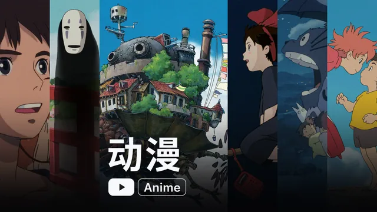 |  | 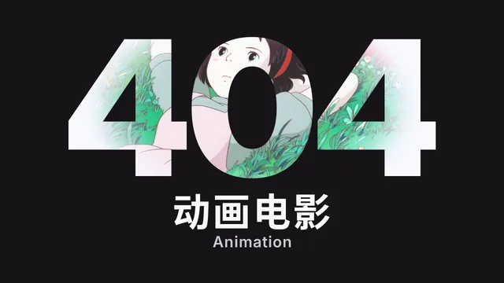 | 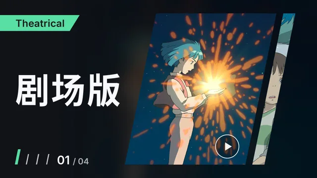 |
| 序幕 | 巨幕 | 404 | 预告 |
| 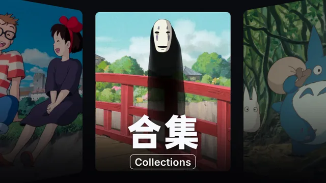 | 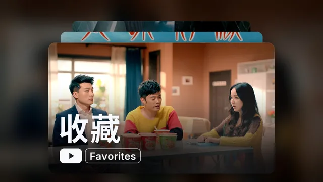 | 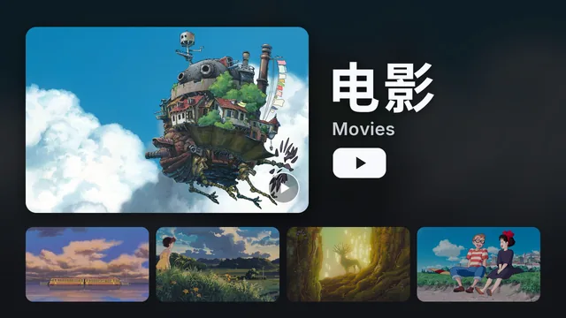 | 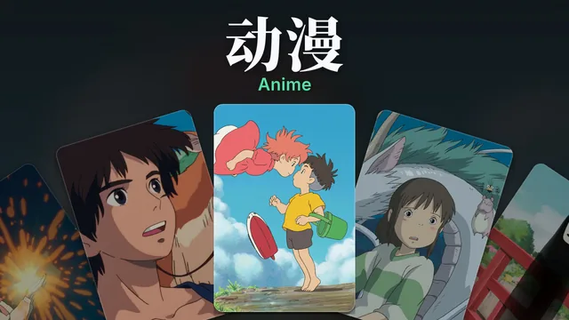 |
| 环幕 | 景深 | 详情 | 扇面 |
| 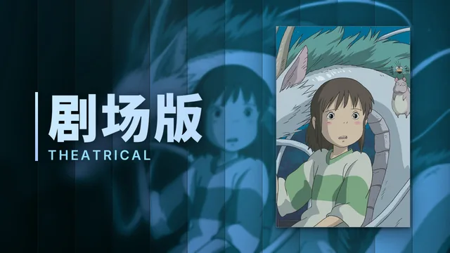 | 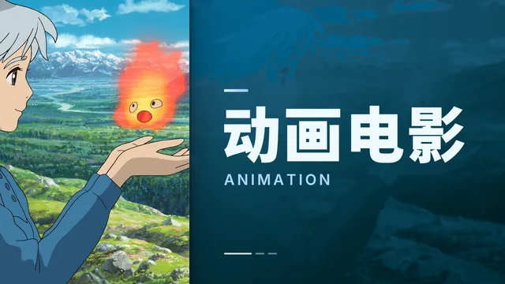 | 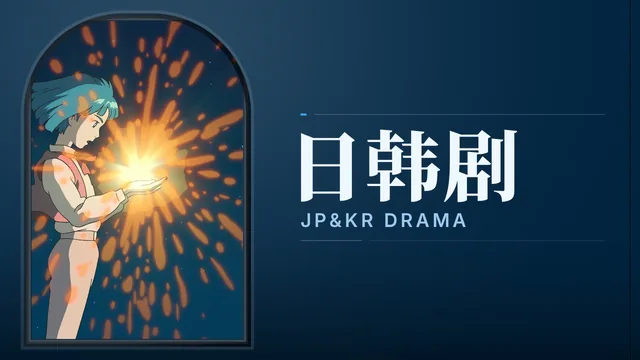 | 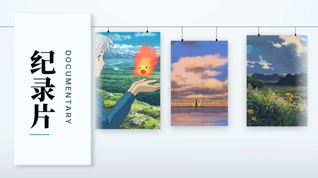 |
| 百叶 | 对开 | 月洞 | 展墙 |

百叶、对开、月洞、展墙是海报系列，完整保留竖版海报，配色跟着每张海报走：百叶是片名在左、海报在右，整幅画面像百叶窗一样逐条翻面；对开是左边的海报从上往下切入，右边取自海报的色块带着片名从下往上升起，前后两张的颜色不会重样，黄色、黄绿这类压暗会发脏的颜色做成浅色块配深色字；月洞是深色墙上开一扇顶天的大拱龛，画装在龛里，换片时旧画顺着龛口滑上去、下一幅从下面推上来，片名刻在右侧的墙上；展墙是纸墙上一块说明板写着竖排片名，横杆上挂着一排大小不一的画，整排缓缓向左滑过，一幅接一幅从板后出来。


## 安装

把 `https://github.com/wio-ki/MoviePilot-Plugins` 加入 MoviePilot 的插件仓库（`PLUGIN_MARKET`），然后在插件市场安装「动态封面工坊」。

## 使用

1. 在插件设置的「基础」页启用插件，选择媒体服务器并保存。
2. 打开插件详情页，选好风格后点「生成全部封面」。

生成在后台进行，可以随时关闭窗口，回来后点「刷新」查看进度。

### 用自己的片库预览

在详情页「风格」页点「生成预览」，插件会用媒体库的真实图片把全部风格各生成一遍，卡片上直接显示你自己片库的效果。预览在后台生成，只保存在 MoviePilot 的插件数据目录里，不会上传，也不会改动媒体库封面。想换一个媒体库，先在「应用到」里选中它。

### 给媒体库单独设置风格

在详情页「风格」页上方的「应用到」里选择媒体库，再点风格卡片，或在「媒体库」页点「换风格」。选「所有媒体库」时改的是默认风格，没有单独设置的媒体库都跟随它。单独设置过的媒体库可以随时恢复跟随默认。

### 动态封面

新安装默认输出动态封面。动图首帧就是完整封面，只显示静态图的客户端看到的也是成品。画面大部分时间静止、只在转场时运动，320×180 一张通常 1.5 到 3 MB。

生成动图需要容器内有 ffmpeg，没有时会自动生成静态封面。

客户端请求的宽度小于动图宽度时，Emby 会把动图压成静态图，所以尺寸越小越容易动起来。默认的 400×225 能满足上面几个客户端；如果某个客户端不动，可以在「GIF 动图」页改成 320×180，然后重新生成封面。

### 素材图片

设置「风格」页的「素材图片」默认是自动匹配。海报系列的风格只用海报。其他风格会先给背景图打分：太暗、发糊的剧照、脸部特写、颜色寡淡的不用，改用这个条目的海报；背景图好看时，同时下载海报和背景图，每个画框选比例合适的那张。必须裁切时围绕人物取景；海报放进宽画框又保不住人物时，会完整显示海报，两侧用它自己的虚化图延伸。

也可以选「只用海报」或「只用背景图」，这个条目没有对应的图时才用另一种。

### 标题

在设置的「标题」页按媒体库名称配置，点「按我的媒体库生成」可以自动填入尚未配置的媒体库。没有配置的媒体库直接使用媒体库名称。

```yaml
电影:
  - 电影        # 主标题
  - MOVIES      # 副标题，可以留空 ""
  - "#58DDA3"   # 点缀色，可选，需要把「点缀色」的颜色来源设为「从标题配置读取」
```

### 字体排版

每款风格都有设计好的字体、字号、字距和间距，所以设置的「字体排版」页默认全部留空。想换字体可以点「字体搭配」里的卡片，字号和间距仍然跟随风格；只有手动填写的项才会覆盖风格的设计。标题放不下时会自动缩小，再不行才折行，单个英文单词不会被拆开。

字体只在用到时下载：纯英文标题不会下载中文字体。内置字体的来源和授权见 [fonts/README.md](fonts/README.md)。

### 电视直播

Emby 和 Jellyfin 的电视直播入口也会出现在媒体库列表里。它的封面常常是手动设置的，所以「全部媒体库」不包含它，需要在「批量更新的媒体库」里勾选，或在详情页单独点「生成」。

图片优先取正在播出节目的海报，没有时用频道图片（通常是台标）。想要更好的效果，可以用下面的自定义图片。

### 自定义图片

把图片放进与媒体库同名的子目录，例如 `/mnt/custom/电影/a.jpg`，然后在「目录与历史」页填写 `/mnt/custom`。插件只读取这个目录，不会改动里面的文件。图片不够时会重复使用。
